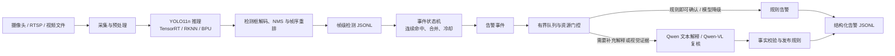

# 端侧实时视频推理与多模态告警系统

**Edge Real-Time Video Inference and Multimodal Alerting System**

在 Jetson Xavier NX、RK3588 和 RDK X5 上运行 C++ YOLO11n 实时视频检测。在 Jetson 和 RK3588 上，事件状态机从连续检测中确认告警，按需调用 Qwen 文本模型和视觉语言模型，再输出带检测事实、证据和降级状态的结构化告警。项目覆盖多后端适配、流水线并发、多模型调度和板端性能排查。

| 工程问题 | 实现与代表性结果 |
| --- | --- |
| 实时视频积压 | Jetson 移除同步视频写出后，固定视频流水线从 **25.12 → 30.09 FPS** |
| 推理与后处理失衡 | RDK X5 在同一 IMX219 无预览窗口中，将推理和后处理从 1/1 增至 2/2 worker，吞吐从 **20.02 → 30.08 FPS**，估算丢帧率从 **33.46% → 0** |
| 低频模型调用干扰检测 | 早期双板告警版本分别运行超过 2 小时，Jetson 和 RK3588 检测达到 **30.00 / 30.04 FPS**。Jetson 在检测窗口结束后执行 VLM，RK3588 同窗低频调用 |
| 事件取证慢 | 7 个相同事件各配对运行 3 次，完整取证均值从 **2,504 → 701 ms**，201 个 JPEG 逐一字节一致 |

[架构](#架构) · [部署矩阵](#部署矩阵) · [实现](#实现) · [实验结果](#实验结果) · [快速验证](#快速验证) · [源码入口](#源码入口)

## 架构



检测和告警消费在独立执行路径上运行，以帧级 JSONL 交接。告警层也可以回放检测输出，以便固定输入检查规则、模型路由和降级。每条待处理事件携带检测事实和事件标识。视觉分支按任务准备关键帧、目标 ROI 或关系上下文裁剪。

## 部署矩阵

| 平台 | C++ 实时检测 | 告警与多模态解释 |
| --- | --- | --- |
| Jetson Xavier NX 8GB | TensorRT GPU 基线。另有 TensorRT DLA0/DLA1 双 worker，保留 GPU fallback | llama.cpp 文本及视觉服务。后续实验将文本推理放在 CPU 上，VLM 视觉编码放在 GPU，语言层和 KV 缓存保留在 CPU |
| RK3588 8GB | RKNN Runtime／RKNPU，多 worker 可配置 NPU 核心 | RKLLM 常驻文本服务，VLM 通过 RKNN 视觉编码与 RKLLM 生成 |
| RDK X5 | Horizon BPU，IMX219 通过 HBN／srcampy 接入 | — |

检测模型为 YOLO11n。后续告警配置使用 Qwen3-0.6B 和 Qwen3-VL-2B。早期验收与后续异构实验使用各自冻结的模型及运行配置。[板端准备与运行入口](docs/runbook.md)

## 实现

### C++ 视频推理

- **后端适配。** 用同一推理接口封装 TensorRT、RKNN 和 BPU。按后端处理输入布局、色彩与归一化、图像尺寸回映和检测头解码，以统一结构输出检测框。
- **并发与背压。** 将采集、预处理、推理、后处理和输出拆成五个阶段。阶段之间使用有界队列，实时模式可丢弃积压旧帧。输出按帧号重排，分别统计缺帧、乱序、队列水位和阶段耗时。
- **吞吐与时延定位。** 用关闭同步写出前后的对照定位 Jetson 输出瓶颈。RDK X5 中，单独增加推理 worker 后，下游队列仍然积压。同步增加后处理 worker 后恢复持续吞吐，P95 同时由 141.94 ms 上升至 165.17 ms。[检测主程序](projects/03_video_pipeline/src/video_pipeline_app.cpp) · [流水线性能报告](projects/03_video_pipeline/reports/runtime_benchmark.md)

### 告警与多模型调度

- **事件触发。** 规则可配置置信度、连续命中、确认窗口、冷却与区域条件。持续命中的同一事件会合并，简单的人车存在事件可直接走规则模板，复杂场景按需触发文本解释和视觉复核。[事件状态机](projects/08_alarm_system/scripts/run_demo/run_event_trigger.py) · [事件路由](projects/08_alarm_system/scripts/service/event_model_dispatch.py)
- **常驻与资源控制。** 模型进程一次加载并复用，事件消费通过有界队列限制积压。结合请求预算、冷却、超时与运行资源决定是否执行模型；调用超时、资源不足或输出校验失败时，保留规则告警和对应状态。[服务入口](projects/08_alarm_system/scripts/service/run_alarm_service.py) · [资源门控](projects/08_alarm_system/scripts/service/resource_gate.py)
- **证据与事实约束。** 从事件时间线生成图像证据。视频索引将时间戳映射到解码序号，在关键帧附近定位后核验目标帧身份，失败时回退顺序读取。告警生成保留检测事实，记录模型输出、校验结果和降级原因。[视频索引](projects/08_alarm_system/scripts/service/indexed_video_reader.py) · [事实校验](projects/08_alarm_system/scripts/run_demo/fact_guard.py) · [告警结构](projects/08_alarm_system/configs/alarm_schema/alarm_event_schema.json)

### Jetson 异构部署

将两个 TensorRT Engine 分别绑定到 DLA0、DLA1。每个检测 worker 在反序列化前显式绑定核心，并记录实际核心及重排等待。原整图仍存在 GPU fallback。分割检测头后，部分实验的 Engine 吞吐提升，但 CPU 外置 DFL、解码和 NMS 成为新的瓶颈。后续调度实验同时检查检测吞吐、帧时延、模型请求结果和可用内存。[双 DLA 检测源码](projects/08_alarm_system/src/detector/dual_dla_detector_service.cpp) · [异构实验](docs/benchmarks.md#jetson-异构与三模协同)

## 实验结果

| 测试范围 | 结果 | 条件或限制 |
| --- | --- | --- |
| Jetson 视频流水线 A/B | **25.12 → 30.09 FPS**，约 +19.8% | 同一视频集及推理后端，对照同步视频写出开关 |
| RK3588 视频流水线 | **30.08 FPS** | 600 秒、3 个 RKNN worker。另有相机 4 小时＋视频 4 小时的长稳记录，视频段记录 8 帧缺失 |
| RDK X5 摄像头 A/B | **20.02 → 30.08 FPS** | 59 秒无预览窗口。另有 7,198 秒摄像头运行记录，约 30.39 FPS |
| 早期双板告警 | Jetson **30.00 FPS / 7,217 s**，RK3588 **30.04 FPS / 7,204 s** | 事件／告警 1,550／1,550 和 765／765。两板各记录两次真实文本调用，视觉调用分别在 Jetson 窗口后、RK3588 窗口内完成 |
| 后续 Jetson 三模同窗 | 两轮约 619 秒，检测 **28.82 / 28.79 FPS** | 两轮共 6 次 LLM 返回，7 次 VLM 请求中 6 次返回。记录到资源拒绝、输出质量校验失败和检测丢帧，完整验收尚未通过 |
| 事件索引供图 | 配对完整取证均值 **2,504 → 701 ms**（−72.0%） | 7 个事件 × 3 次。索引已预建，测量含读取、裁剪与保存 |

[详细对照、原始记录编号和稳定性口径](docs/benchmarks.md) · [早期双板告警验收报告](reports/final_acceptance_report.md)

## 快速验证

用 Python 3.10 及以上在仓库根目录回放合成检测帧。示例执行真实的事件规则、模板告警和 JSONL 校验，适合快速了解系统；板端性能与真实模型见实验记录。

```bash
p=projects/08_alarm_system
id="pc_replay_$(date +%Y%m%d_%H%M%S)_$$"
raw="runs/$id/detector.jsonl"

python3 "$p/scripts/service/testing/fake_resident_detector.py" \
  --run-id "$id" --output "$raw" --frames 96 --sleep-ms 0

python3 "$p/scripts/service/run_alarm_service.py" \
  --run-id "$id" --board pc --environment-baseline-id pc_replay \
  --detector-mode replay --detector-raw "$raw" \
  --rules "$p/configs/event_rules/jetson_rules.yaml" \
  --model-config "$p/configs/models/jetson_model_combo.yaml" \
  --text-mode template --vlm-mode stub --asset-mode none

python3 "$p/scripts/benchmark/validate_alarm_jsonl.py" \
  --input "benchmark/raw/08_alarm_system/pc/alarms/${id}_alarms.jsonl" \
  --schema "$p/configs/alarm_schema/alarm_event_schema.json"
```

预期生成 3 条事件、3 条告警，并输出校验状态 `pass`。[更多运行命令与构建说明](docs/runbook.md)

## 源码入口

| 入口 | 内容 |
| --- | --- |
| [projects/03_video_pipeline](projects/03_video_pipeline) | 三平台 C++ 流水线，后端配置、运行工具和历史性能报告 |
| [projects/08_alarm_system](projects/08_alarm_system) | 后续告警服务、双 DLA 检测变体、RKNN/RKLLM 服务源码、事件规则、模型配置和测试 |
| [reports](reports) | 早期双板版本的验收、运行和故障记录 |
| [docs/benchmarks.md](docs/benchmarks.md) | 测试矩阵、指标定义与已验证范围 |
| [docs/runbook.md](docs/runbook.md) | 本机回放、C++ 构建和真机运行入口 |

仓库采用 [MIT 许可证](LICENSE)。目标板 SDK、推理运行库、模型权重、板端引擎及原始视频由使用者按目标设备准备。
